<p align="center">
  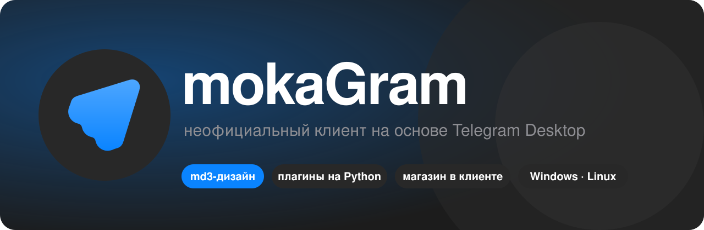
</p>

<p align="center">
  <a href="https://moka.wtf"></a>
  <a href="https://github.com/ecronxy/mokagram/releases/latest"></a>
  <a href="LICENSE"></a>
  <a href="https://t.me/ecronx"></a>
</p>

<p align="center">
  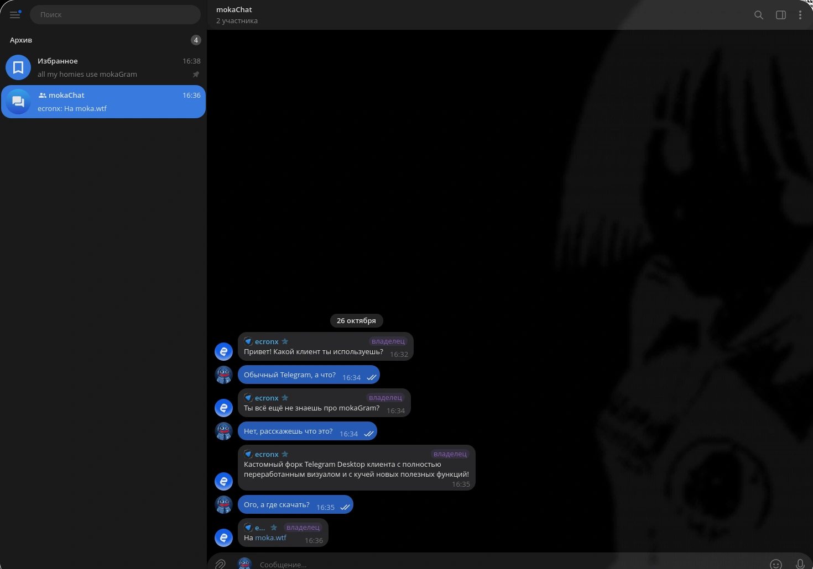
</p>

## Что это

**mokaGram** — кастомный форк Telegram Desktop с полностью переработанным визуалом в md3-стиле и кучей новых полезных функций. Все секции в настройках лежат отдельными скруглёнными карточками, каждая функция включается отдельно, и включать нужно только то, что нужно.

Клиент работает с обычным аккаунтом Telegram и обычными серверами. Плагины из экстеры, но на ПК: свой API на Python и магазин прямо в клиенте.

## Скачать

Последняя сборка: **[v0.1.1](https://github.com/ecronxy/mokagram/releases/latest)**

| Система | Файл |
|---|---|
| **Windows** | [mokagram-win-x64.zip](https://github.com/ecronxy/mokagram/releases/download/v0.1.1/mokagram-win-x64.zip) |
| **Linux** | [AppImage](https://github.com/ecronxy/mokagram/releases/download/v0.1.1/mokagram-x86_64.AppImage) · [.deb](https://github.com/ecronxy/mokagram/releases/download/v0.1.1/mokagram_0.1.1_amd64.deb) · [.rpm](https://github.com/ecronxy/mokagram/releases/download/v0.1.1/mokagram-0.1.1-1.x86_64.rpm) · [pacman](https://github.com/ecronxy/mokagram/releases/download/v0.1.1/mokagram-0.1.1-1-x86_64.pkg.tar.zst) · [tar.xz](https://github.com/ecronxy/mokagram/releases/download/v0.1.1/mokagram-linux-x64.tar.xz) |

Сборка для Windows без подписи разработчика, система может предупредить при первом запуске.

## Настройки mokaGram

Всё своё лежит в одном месте: **Настройки → Настройки mokaGram**.

<table>
<tr>
<td width="38%" valign="middle">

Десять разделов: плагины, кастомизация, приватность, безопасность, удалённые, чаты, музыка, система, инструменты и быстрые команды. Внутри каждой функции свой переключатель, а у ползунков и выбора есть кнопка «Сбросить».

</td>
<td width="62%" align="center">
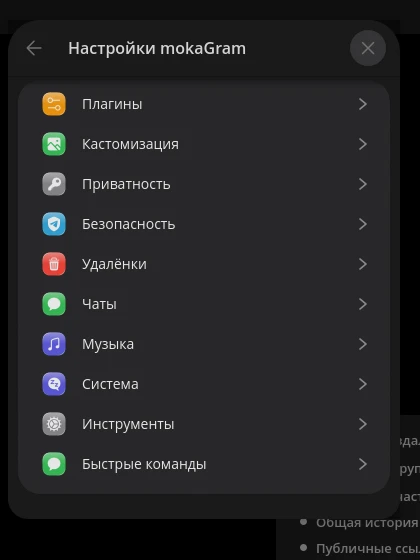
</td>
</tr>
</table>

## Что внутри

<table>
<tr>
<td align="center" width="33%">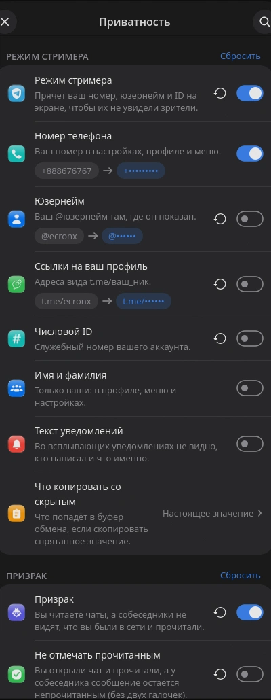</td>
<td align="center" width="33%">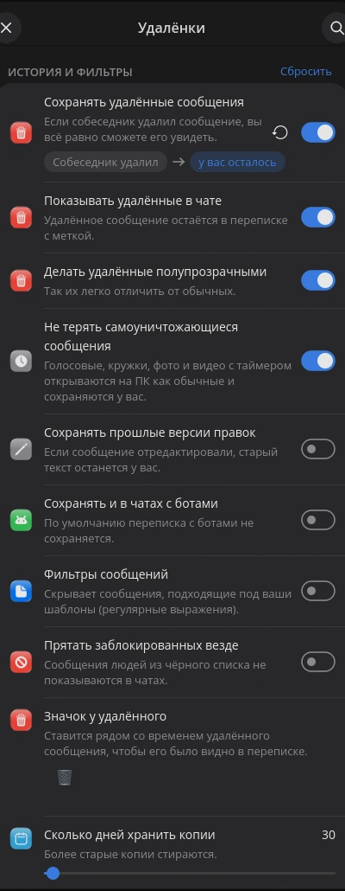</td>
<td align="center" width="33%">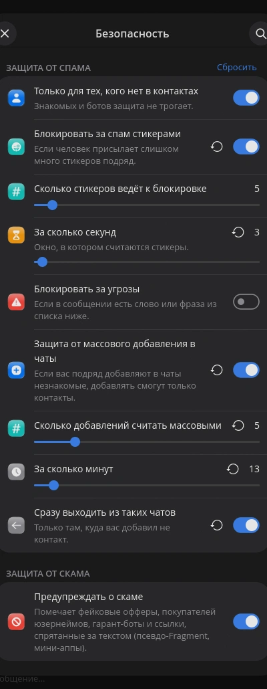</td>
</tr>
<tr>
<td valign="top">

### Приватность

- **Режим стримера** прячет номер телефона, юзернейм и числовой ID на экране
- **Призрак**: не отмечать прочитанным и скрывать, что ты в сети
- Что копируется со скрытым, настраивается отдельно

</td>
<td valign="top">

### Удалённые и правки

- Сохраняются удалённые сообщения и **прошлые версии правок**
- Работает и в чатах с ботами
- Фильтры сообщений, срок хранения копий в днях
- Заблокированных можно прятать везде

</td>
<td valign="top">

### Безопасность

- Писать могут только те, кто есть в контактах
- Блокировка за спам стикерами со своими порогами
- Защита от массового добавления в чаты
- Предупреждение о скаме

</td>
</tr>
</table>

<table>
<tr>
<td align="center" width="33%">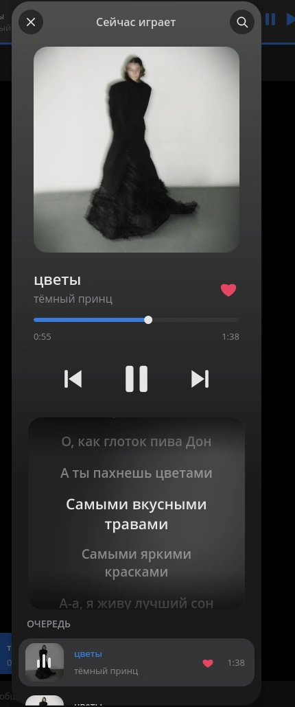</td>
<td align="center" width="33%">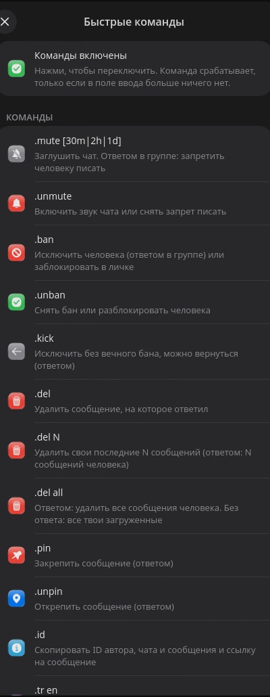</td>
<td align="center" width="33%">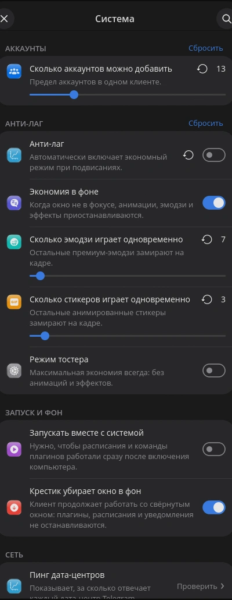</td>
</tr>
<tr>
<td valign="top">

### Музыка

- Цвета плеера берутся из обложки
- **Текст песни** с подсветкой строки
- Плазма за текстом
- Автовоспроизведение следующего

</td>
<td valign="top">

### Быстрые команды

Пишешь команду прямо в чате:

`.mute` `.unmute` `.ban` `.unban` `.kick` `.pin` `.unpin` `.id` `.del` `.del N` `.del all`

Включаются одним переключателем.

</td>
<td valign="top">

### Система

- Лимит одновременно играющих эмодзи и стикеров
- **Анти-лаг** и экономия в фоне
- Режим тостера для слабых машин
- Крестик убирает окно в фон
- Больше аккаунтов, траты звёзд

</td>
</tr>
</table>

<table>
<tr>
<td align="center" width="33%">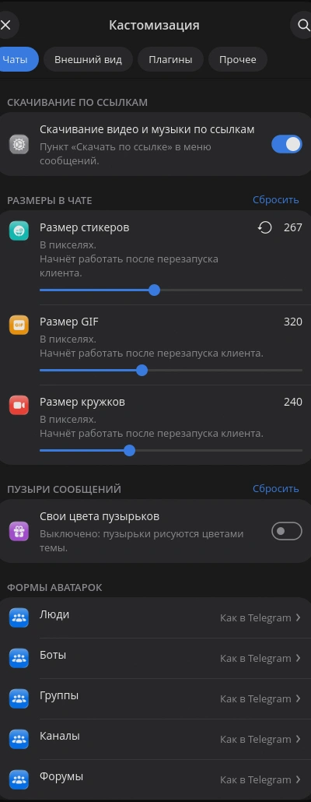</td>
<td align="center" width="33%">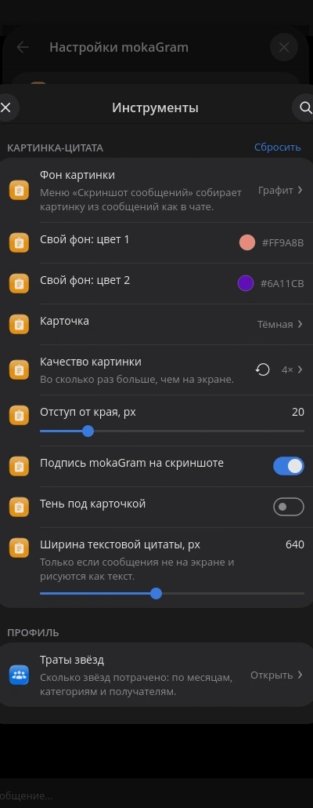</td>
<td align="center" width="33%">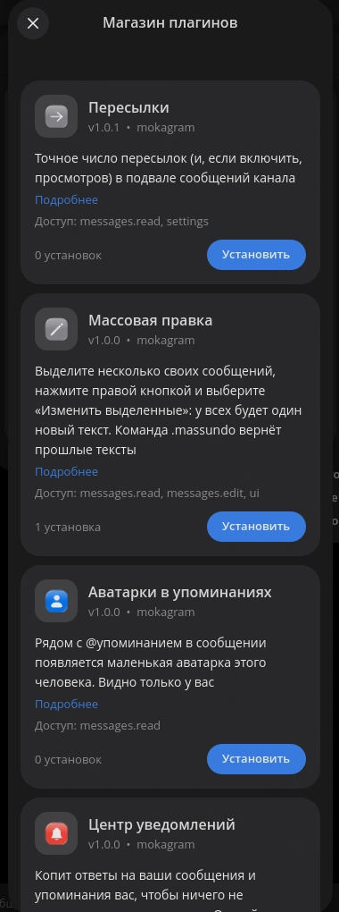</td>
</tr>
<tr>
<td valign="top">

### Кастомизация

- Скачивание видео и музыки по ссылкам
- Размеры стикеров, GIF и кружков
- Свои цвета пузырьков
- Форма аватарок для людей, ботов, групп и каналов

</td>
<td valign="top">

### Инструменты

- **Скриншот сообщений** карточкой (см. ниже)
- Траты звёзд по категориям и получателям
- Качество картинки, отступы, ширина цитаты

</td>
<td valign="top">

### Плагины

- Магазин прямо в клиенте, установка одной кнопкой
- Права выдаются при установке
- Свои плагины на Python (см. [API](docs-plugins-api.md))

</td>
</tr>
</table>

### Скриншот сообщений

Выделяешь сообщения и получаешь аккуратную карточку: фон, светлая или тёмная карточка, имя и аватарку можно скрыть мышкой (размытием, пикселями или заливкой), внизу по желанию подпись mokaGram.

<p align="center">
  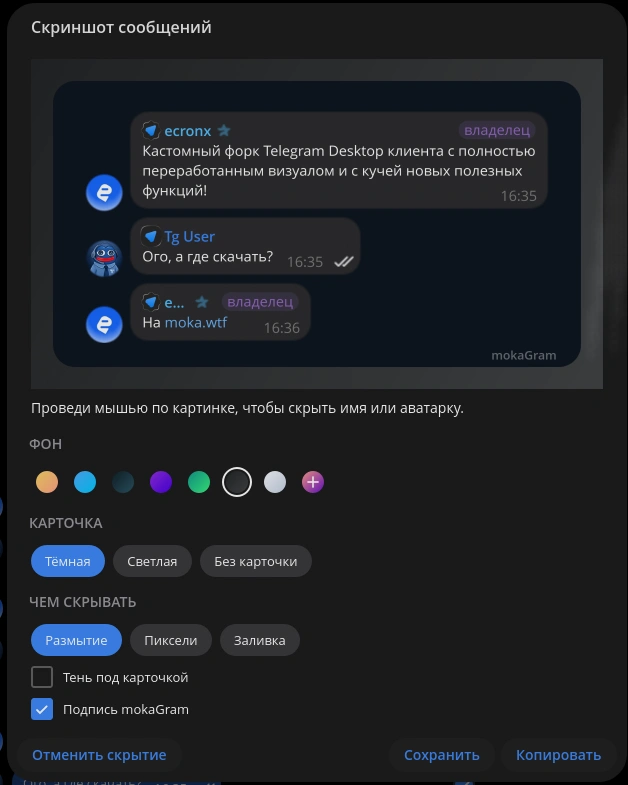
</p>

## Плагины

Плагин — один файл `.plugin` с классом, наследующим `BasePlugin`. Метаданные (`__id__`, `__name__`, `__version__`, `__permissions__`) лежат в самом файле.

```python
__id__ = "showcase"
__name__ = "Showcase"
__description__ = "Пример: кнопки, меню, окно с формой, команда, события, фильтр"
__author__ = "mokagram"
__version__ = "1.0"
__permissions__ = ["messages.read", "messages.send", "messages.edit"]

from base_plugin import BasePlugin, command


class Showcase(BasePlugin):
    # Команда: .hello мир. Возвращённая строка заменяет текст в поле ввода.
    @command("hello", "приветствие, .hello имя")
    def hello(self, ctx):
        name = ctx.args or "мир"
        return "Привет, %s!" % name
```

- Права: `messages.read`, `messages.send`, `messages.edit`, `messages.delete`, `tl.read`, `tl.write`, `clipboard`, `network`, `files`. Без права вызов возвращает `None`, плагин не падает.
- У плагина лимит 300 действий в минуту, каждое действие пишется в журнал.
- Пункты в контекстном меню сообщения, меню чата, профиле, скрепке, боковом меню, кнопки в шапке чата и рядом с полем ввода.

Полное описание: **[docs-plugins-api.md](docs-plugins-api.md)**, пример: [examples/showcase.plugin](examples/showcase.plugin).

## Где что лежит

```text
Telegram/SourceFiles/mokagram/
├── plugins/    движок плагинов, магазин, права
├── msginfo/    окно «Информация о сообщении»
├── music/      плеер
├── streamer/   режим стримера
├── ghost/      призрак
├── commands/   быстрые команды
└── settings/   настройки mokaGram
patches/        правки поверх upstream
```

Всё добавленное лежит в `Telegram/SourceFiles/mokagram/`, остальные правки помечены `Mokagram:`. Так форк проще подтягивать к свежему Telegram Desktop.

## Сборка

mokaGram собирается так же, как Telegram Desktop:

- [Windows](docs/building-win.md)
- [GNU/Linux (Docker)](docs/building-linux.md)

Исходники Telegram Desktop и список сторонних библиотек: [telegramdesktop/tdesktop](https://github.com/telegramdesktop/tdesktop).

## Авторство и лицензия

> **Основано на mokaGram, автор [@ecronx](https://t.me/ecronx) (https://t.me/ecronx). https://github.com/ecronxy/mokagram**

mokaGram основан на [Telegram Desktop](https://github.com/telegramdesktop/tdesktop) (© The Telegram Desktop Authors, GPLv3 с исключением OpenSSL). Доработки © 2026 [@ecronx](https://t.me/ecronx), лицензия та же, GPLv3, плюс условие об сохранении авторства.

Кто берёт исходники или сборки mokaGram, обязан сохранить [уведомление](MOKAGRAM_NOTICE.md) и указать авторство в README и в окне «О программе». При нарушении лицензия прекращается.

*Anyone using mokaGram source code **must credit the author** ([@ecronx](https://t.me/ecronx), https://github.com/ecronxy/mokagram) in the README and the About window and keep the [notice](MOKAGRAM_NOTICE.md).*

<p align="center">
  <a href="https://moka.wtf">moka.wtf</a> · <a href="https://t.me/ecronx">@ecronx</a> · <a href="https://github.com/ecronxy/mokagram/releases">релизы</a>
</p>
