# Возможности mokaGram

## Настройки mokaGram

Всё своё лежит в одном месте: **Настройки → Настройки mokaGram**.

<table>
<tr>
<td width="38%" valign="middle">

Десять разделов: плагины, кастомизация, приватность, безопасность, удалённые, чаты, музыка, система, инструменты и быстрые команды. Внутри каждой функции свой переключатель, а у ползунков и выбора есть кнопка «Сбросить».

</td>
<td width="62%" align="center">
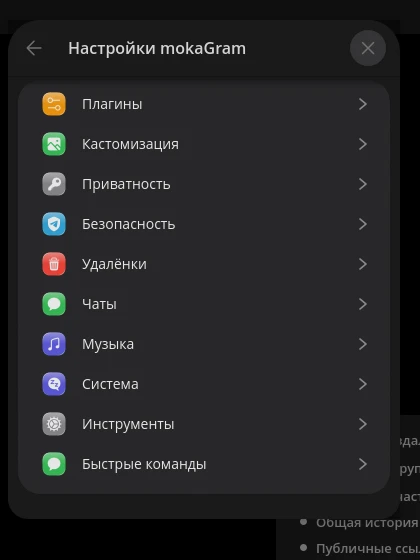
</td>
</tr>
</table>

## Что внутри

<table>
<tr>
<td align="center" width="33%">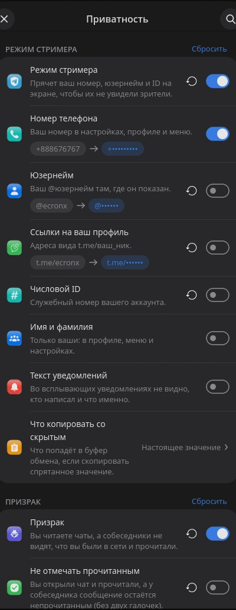</td>
<td align="center" width="33%">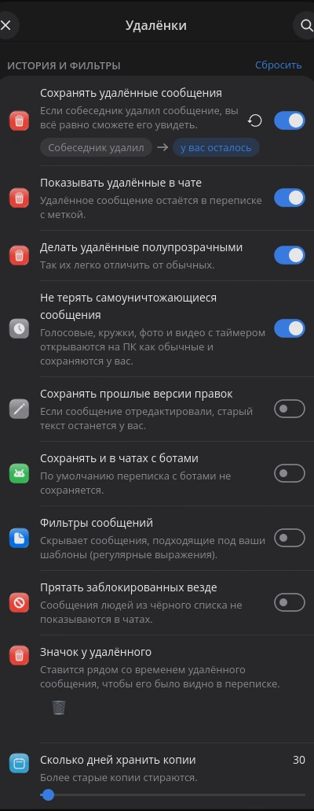</td>
<td align="center" width="33%">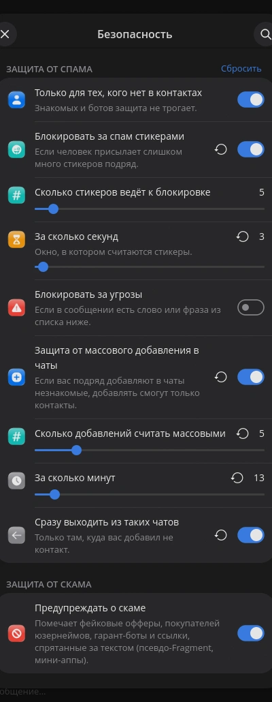</td>
</tr>
<tr>
<td valign="top">

### Приватность

- **Режим стримера** прячет номер телефона, юзернейм и числовой ID на экране
- **Призрак**: не отмечать прочитанным и скрывать, что ты в сети
- Что копируется со скрытым, настраивается отдельно

</td>
<td valign="top">

### Удалённые и правки

- Сохраняются удалённые сообщения и **прошлые версии правок**
- Работает и в чатах с ботами
- Фильтры сообщений, срок хранения копий в днях
- Заблокированных можно прятать везде

</td>
<td valign="top">

### Безопасность

- Писать могут только те, кто есть в контактах
- Блокировка за спам стикерами со своими порогами
- Защита от массового добавления в чаты
- Предупреждение о скаме

</td>
</tr>
</table>

<table>
<tr>
<td align="center" width="33%">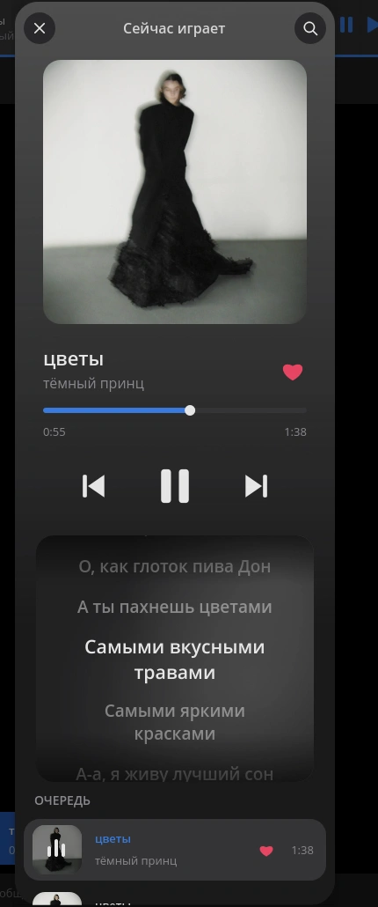</td>
<td align="center" width="33%">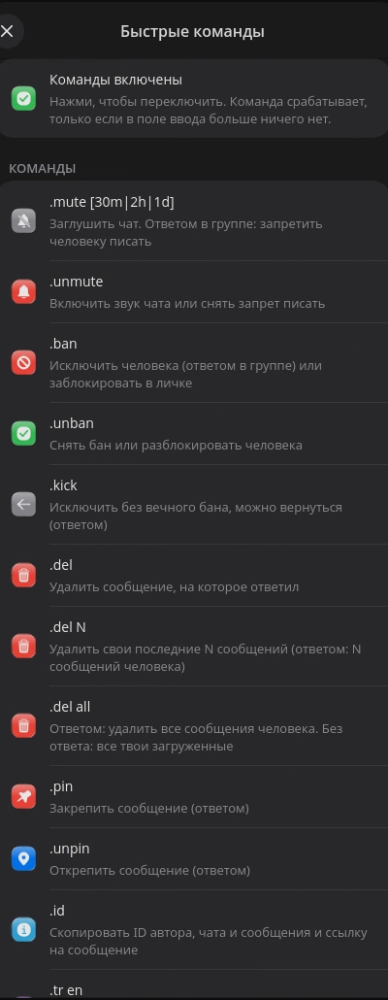</td>
<td align="center" width="33%">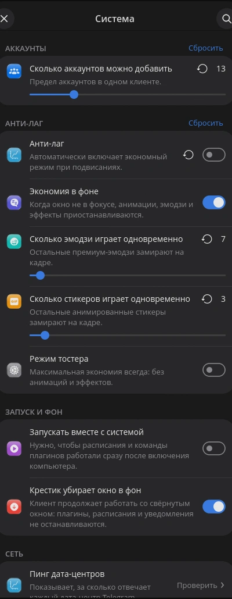</td>
</tr>
<tr>
<td valign="top">

### Музыка

- Цвета плеера берутся из обложки
- **Текст песни** с подсветкой строки
- Плазма за текстом
- Автовоспроизведение следующего

</td>
<td valign="top">

### Быстрые команды

Пишешь команду прямо в чате:

`.mute` `.unmute` `.ban` `.unban` `.kick` `.pin` `.unpin` `.id` `.del` `.del N` `.del all`

Включаются одним переключателем.

</td>
<td valign="top">

### Система

- Лимит одновременно играющих эмодзи и стикеров
- **Анти-лаг** и экономия в фоне
- Режим тостера для слабых машин
- Крестик убирает окно в фон
- Больше аккаунтов, траты звёзд

</td>
</tr>
</table>

<table>
<tr>
<td align="center" width="33%">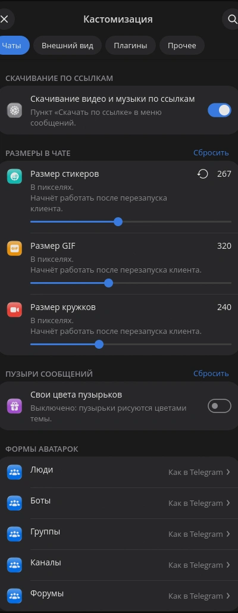</td>
<td align="center" width="33%">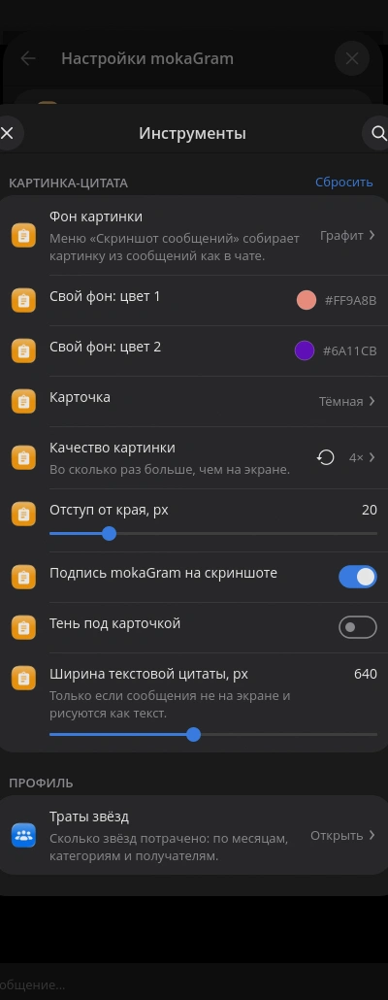</td>
<td align="center" width="33%">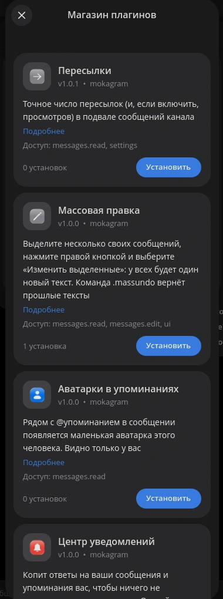</td>
</tr>
<tr>
<td valign="top">

### Кастомизация

- Скачивание видео и музыки по ссылкам
- Размеры стикеров, GIF и кружков
- Свои цвета пузырьков
- Форма аватарок для людей, ботов, групп и каналов

</td>
<td valign="top">

### Инструменты

- **Скриншот сообщений** карточкой (см. ниже)
- Траты звёзд по категориям и получателям
- Качество картинки, отступы, ширина цитаты

</td>
<td valign="top">

### Плагины

- Магазин прямо в клиенте, установка одной кнопкой
- Права выдаются при установке
- Свои плагины на Python (см. [API](docs-plugins-api.md))

</td>
</tr>
</table>

### Скриншот сообщений

Выделяешь сообщения и получаешь аккуратную карточку: фон, светлая или тёмная карточка, имя и аватарку можно скрыть мышкой (размытием, пикселями или заливкой), внизу по желанию подпись mokaGram.

  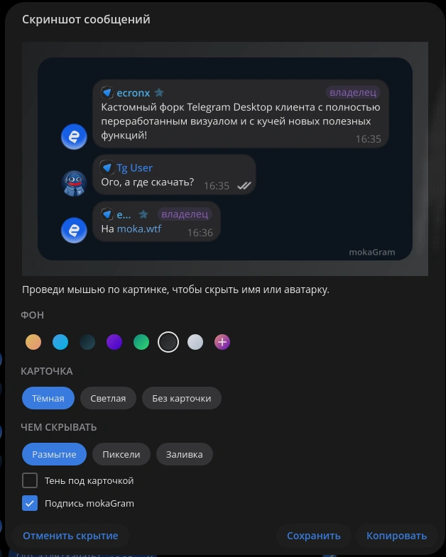

